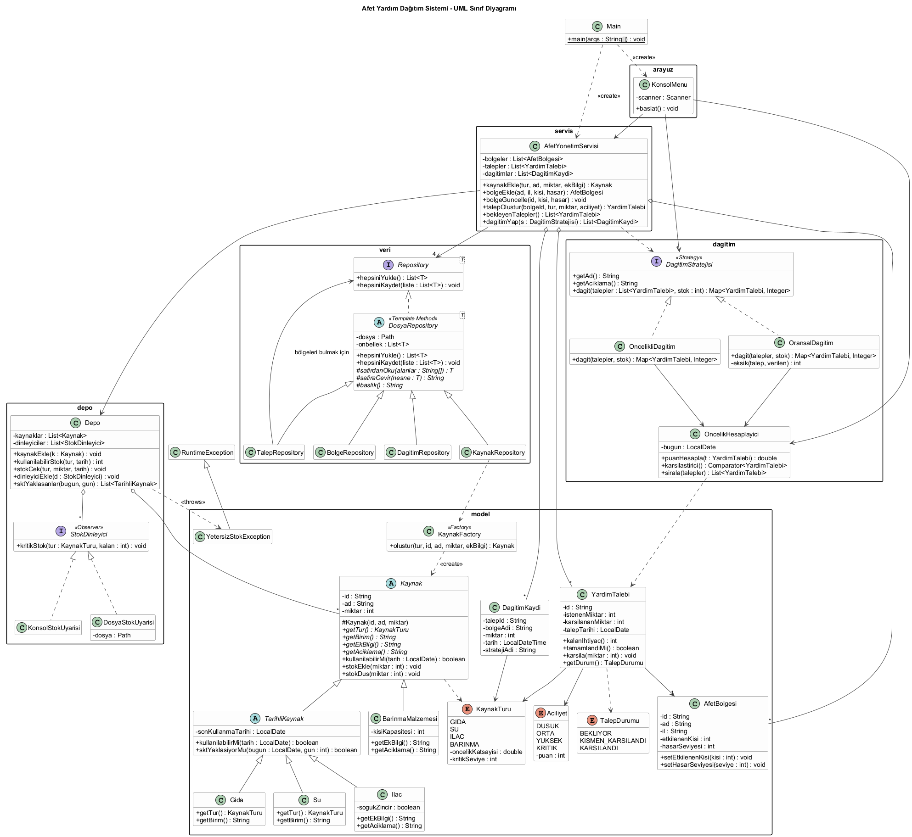

# Afet Yardım Dağıtım Sistemi

Nesneye Yönelik Programlama dersi proje ödevi.

**Konu:** Afet ve Acil Durum Yönetimi - Yardım kaynaklarının öncelik ve ihtiyaç durumuna göre dağıtılması

Deprem, sel gibi afetlerden sonra bağışlarla toplanan yardım malzemeleri (su, gıda, ilaç, çadır/battaniye) bir depoda toplanıyor. Afet bölgelerinden gelen yardım talepleri; aciliyetine, bölgenin hasar durumuna, etkilenen kişi sayısına ve talebin ne kadar süredir beklediğine göre puanlanıyor. Stok herkese yetmediğinde depodaki malzeme bu puanlara göre bölgelere dağıtılıyor.

Uygulama konsol üzerinden çalışıyor, bütün veriler `veri/` klasöründeki metin dosyalarında saklanıyor. Program kapatılıp açıldığında kaldığı yerden devam ediyor.

## Özellikler

- Depoya kaynak (bağış/tedarik) girişi. Aynı ürün tekrar gelirse yeni kayıt açılmadan stoğu artırılıyor
- Afet bölgesi ekleme, listeleme ve güncelleme (etkilenen kişi sayısı, hasar seviyesi 1-5)
- Yardım talebi oluşturma (bölge, kaynak türü, miktar, aciliyet)
- Bekleyen talepleri öncelik puanına göre sıralı listeleme
- İki farklı dağıtım yöntemi:
  - **Öncelikli dağıtım:** en acil talep önce tamamen karşılanıyor
  - **Oransal dağıtım:** stok yetmezse herkese öncelik puanı ve ihtiyacı oranında pay veriliyor
- Depodan çıkışta son kullanma tarihi en yakın ürün önce kullanılıyor (FEFO), tarihi geçen ürün dağıtılmıyor
- Stok kritik seviyenin altına düşünce ekranda uyarı veriliyor ve `veri/uyarilar.log` dosyasına yazılıyor
- Dağıtım geçmişi ve genel durum raporu (tür bazında stok/ihtiyaç/eksik, SKT'si yaklaşan ürünler)

## Kullanılan Teknolojiler

- Java 17 (daha yeni sürümlerde de çalışır)
- Maven
- JUnit 5 (birim testleri)
- PlantUML (UML diyagramı)

## Kurulum ve Çalıştırma

### IntelliJ IDEA ile

1. Projeyi klonlayın:
   ```bash
   git clone https://github.com/YCOzba/AfetYardimDagitim.git
   ```
2. IntelliJ IDEA'da `File > Open` ile proje klasörünü açın (pom.xml'i görünce Maven projesi olarak açılır).
3. `src/main/java/afetyonetim/Main.java` dosyasını açıp **Run** deyin.

Program, çalışma klasöründeki `veri/` klasörünü kullanır. IntelliJ'de çalışma klasörü varsayılan olarak proje klasörü olduğu için içindeki örnek veriler otomatik yüklenir.

### Komut satırından

```bash
mvn compile
java -cp target/classes afetyonetim.Main
```

### Testleri çalıştırmak

IntelliJ'de `src/test/java` klasörüne sağ tıklayıp **Run 'All Tests'** ya da:

```bash
mvn test
```

## Proje Yapısı

```
AfetYardimDagitim/
├── pom.xml
├── README.md
├── proje_takimi.txt
├── docs/
│   ├── uml_sinif_diyagrami.puml
│   └── uml_sinif_diyagrami.png
├── veri/                         -> kalıcı veriler (örnek verilerle geliyor)
│   ├── kaynaklar.txt
│   ├── bolgeler.txt
│   ├── talepler.txt
│   └── dagitimlar.txt
└── src/
    ├── main/java/afetyonetim/
    │   ├── Main.java
    │   ├── model/       -> Kaynak hiyerarşisi, AfetBolgesi, YardimTalebi, enumlar
    │   ├── depo/        -> Depo ve stok uyarı (observer) sınıfları
    │   ├── dagitim/     -> öncelik hesaplama ve dağıtım stratejileri
    │   ├── veri/        -> dosya işlemleri (repository)
    │   ├── servis/      -> AfetYonetimServisi
    │   ├── arayuz/      -> KonsolMenu
    │   └── util/        -> tarih formatı
    └── test/java/afetyonetim/    -> birim testleri
```

## Sınıflar

| Sınıf | Görevi |
|---|---|
| `Kaynak` (abstract) | Bütün yardım malzemelerinin ortak üst sınıfı. id, ad, miktar ve stok ekleme/düşme işlemleri |
| `TarihliKaynak` (abstract) | Son kullanma tarihi olan kaynaklar için ara sınıf. Tarihi geçmişse kullanılamaz |
| `Gida`, `Su`, `Ilac` | TarihliKaynak'tan türeyen kaynaklar. İlaçta ayrıca soğuk zincir bilgisi var |
| `BarinmaMalzemesi` | Çadır, battaniye gibi tarihi olmayan malzemeler, kişi kapasitesi tutuluyor |
| `KaynakFactory` | Türüne göre doğru Kaynak nesnesini oluşturuyor |
| `AfetBolgesi` | Bölge adı, il, etkilenen kişi sayısı, hasar seviyesi |
| `YardimTalebi` | Bir bölgenin bir kaynak türü için yaptığı talep. Karşılanan miktar ve durum burada |
| `DagitimKaydi` | Yapılan her gönderimin kaydı (hangi talebe, ne kadar, ne zaman, hangi yöntemle) |
| `Depo` | Kaynakları tutuyor. Stok sorgulama, FEFO ile stok çekme, kritik stok bildirimi |
| `StokDinleyici` (interface) | Stok kritik seviyeye inince haber alacak sınıfların arayüzü |
| `KonsolStokUyarisi`, `DosyaStokUyarisi` | Uyarıyı ekrana / log dosyasına yazan dinleyiciler |
| `OncelikHesaplayici` | Talebin öncelik puanını hesaplıyor ve talepleri sıralıyor |
| `DagitimStratejisi` (interface) | Dağıtım algoritmalarının ortak arayüzü |
| `OncelikliDagitim`, `OransalDagitim` | İki farklı dağıtım algoritması |
| `Repository<T>` (interface) | Veri yükleme/kaydetme arayüzü |
| `DosyaRepository<T>` (abstract) | Dosyaya okuma/yazma akışı. Satır çevirme işini alt sınıflara bırakıyor |
| `KaynakRepository`, `BolgeRepository`, `TalepRepository`, `DagitimRepository` | Her veri türü için dosya işlemleri |
| `AfetYonetimServisi` | Menü ile diğer katmanlar arasındaki sınıf, işlemleri yönetiyor ve kaydediyor |
| `KonsolMenu` | Kullanıcıdan veri alıp sonuçları ekrana yazdırıyor |

## Nesneye Yönelik Programlama Kavramları

**Sınıf ve nesne:** Gerçek hayattaki kavramlar (kaynak, bölge, talep, depo) sınıf olarak modellendi.

**Kapsülleme (Encapsulation):** Bütün alanlar `private`. Örneğin `Kaynak` sınıfında `miktar` dışarıdan doğrudan değiştirilemiyor, sadece `stokEkle()` ve `stokDus()` ile değişiyor ve bu metotlar negatif miktar ya da stoktan fazla çekme gibi hatalı durumları engelliyor. `YardimTalebi.karsila()` de talep edilenden fazla yardım verilmesine izin vermiyor. `AfetBolgesi` setter'larında hasar seviyesinin 1-5 arasında olması kontrol ediliyor. Listeler dışarıya `Collections.unmodifiableList` ile veriliyor.

**Kalıtım (Inheritance):**
```
Kaynak (abstract)
 ├── TarihliKaynak (abstract)
 │    ├── Gida
 │    ├── Su
 │    └── Ilac
 └── BarinmaMalzemesi

DosyaRepository<T> (abstract)
 ├── KaynakRepository
 ├── BolgeRepository
 ├── TalepRepository
 └── DagitimRepository
```

**Soyutlama (Abstraction):** `Kaynak`, `TarihliKaynak` ve `DosyaRepository` soyut sınıflar; `DagitimStratejisi`, `StokDinleyici` ve `Repository` arayüzler. Örneğin `Kaynak` sınıfında `getTur()`, `getBirim()`, `getAciklama()` soyut metotlar, her alt sınıf kendine göre dolduruyor.

**Çok biçimlilik (Polymorphism):**
- `Depo` sınıfı listedeki her kaynak için `kaynak.kullanilabilirMi(tarih)` çağırıyor. Gıda/su/ilaçta tarih kontrolü yapılıyor, barınma malzemesinde yapılmıyor. Depo hangi alt sınıf olduğunu bilmiyor.
- `Ilac`, `getEkBilgi()` ve `getAciklama()` metotlarını override edip `super` ile üst sınıfın sonucuna soğuk zincir bilgisini ekliyor.
- Servis `strateji.dagit(...)` çağırıyor, seçilen nesneye göre öncelikli ya da oransal algoritma çalışıyor.
- Depo, dinleyici listesindeki her nesnenin `kritikStok()` metodunu çağırıyor; biri ekrana biri dosyaya yazıyor.

## SOLID Prensipleri

- **S - Single Responsibility:** Her sınıfın tek işi var. `OncelikHesaplayici` sadece puan hesaplıyor, repository sınıfları sadece dosya işi yapıyor, `KonsolMenu` sadece giriş/çıkış yapıyor, `Depo` sadece stok yönetiyor.
- **O - Open/Closed:** Yeni bir dağıtım yöntemi eklemek için `DagitimStratejisi`'ni uygulayan yeni bir sınıf yazıp `Main`'deki listeye eklemek yeterli; servis ve menüde değişiklik gerekmiyor. Aynı şekilde yeni bir uyarı yöntemi (ör. SMS) için sadece yeni bir `StokDinleyici` yazılıyor.
- **L - Liskov Substitution:** `Kaynak` beklenen her yerde `Gida`, `Su`, `Ilac` ya da `BarinmaMalzemesi` kullanılabiliyor. `DagitimStratejisi` yerine iki strateji de sorunsuz kullanılabiliyor (testlerde de aynı arayüz üzerinden test edildi).
- **I - Interface Segregation:** Arayüzler küçük tutuldu. `StokDinleyici` tek metotlu, `Repository` sadece yükle/kaydet içeriyor, `DagitimStratejisi` sadece dağıtımla ilgili.
- **D - Dependency Inversion:** `AfetYonetimServisi` somut dosya sınıflarına değil `Repository<T>` arayüzüne bağlı, strateji de dışarıdan veriliyor. Bütün nesneler `Main` içinde oluşturulup constructor üzerinden veriliyor. Bu sayede testlerde geçici klasör kullanan repository'ler verilebildi.

## Tasarım Kalıpları

1. **Strategy:** `DagitimStratejisi` arayüzü ve `OncelikliDagitim` / `OransalDagitim` sınıfları. Kullanıcı menüden yöntemi seçiyor, servis hangi algoritmanın çalıştığını bilmeden `dagit()` metodunu çağırıyor.
2. **Observer:** `Depo` (subject) ve `StokDinleyici` (observer). Stok kritik seviyenin altına inince depo kayıtlı bütün dinleyicilere haber veriyor (`KonsolStokUyarisi`, `DosyaStokUyarisi`).
3. **Factory:** `KaynakFactory.olustur()` türe göre doğru alt sınıfı oluşturuyor. Hem menüden kaynak eklerken hem de dosyadan okurken kullanılıyor, böylece `new Gida(...)`, `new Ilac(...)` gibi kodlar tek yerde.
4. **Template Method:** `DosyaRepository` sınıfındaki `hepsiniYukle()` / `hepsiniKaydet()` okuma-yazma akışını belirliyor; satırın nesneye çevrilmesi (`satirdanOku`, `satiraCevir`) alt sınıflarda yapılıyor.

Ayrıca veri erişimi için **Repository** yapısı kullanıldı.

## Algoritma

### Öncelik puanı

```
puan = ( aciliyet puanı                       (Düşük 10, Orta 20, Yüksek 30, Kritik 40)
       + hasar seviyesi * 6                   (1-5 arası)
       + etkilenen kişi / 1000                (en fazla 20)
       + bekleme günü * 2 )                   (en fazla 10)
       * kaynak türü katsayısı                (İlaç 1.5, Su 1.4, Gıda 1.2, Barınma 1.1)
```

Bekleme puanı, düşük öncelikli taleplerin sürekli geride kalıp hiç karşılanmamasını önlemek için eklendi (aging). Tür katsayısı ise aynı durumdaki iki talepten hayati olanı (ilaç, su) öne alıyor. Puanlar eşitse önce gelen talep önce karşılanıyor.

Örnek: Antakya (hasar 5, 48.000 kişi), Kritik su talebi, 2 gündür bekliyor:
`(40 + 30 + 20 + 4) * 1.4 = 131.6`

### Öncelikli dağıtım (greedy + öncelik kuyruğu)

Talepler puana göre `PriorityQueue`'ya ekleniyor. Kuyruktan en yüksek puanlı talep alınıp stok yettiği kadar karşılanıyor, stok bitene kadar devam ediliyor. Karmaşıklık O(n log n).

### Oransal dağıtım

Stok, toplam ihtiyaçtan azsa her talebin ağırlığı `öncelik puanı * kalan ihtiyaç` olarak hesaplanıyor ve stok bu ağırlıklara göre bölünüyor. Bir talebe düşen pay ihtiyacından fazlaysa sadece ihtiyacı kadar veriliyor, artan kısım bir sonraki turda diğer taleplere dağıtılıyor. Tam sayıya yuvarlamadan kalan birkaç birim öncelik sırasına göre birer birer veriliyor. Böylece stoğun tamamı kullanılıyor ve kimseye istediğinden fazla gitmiyor.

### Depodan stok çekme (FEFO)

Bir türden stok çekilirken o türdeki ürünler son kullanma tarihine göre sıralanıyor ve tarihi en yakın olandan başlanıyor. Böylece ürünlerin depoda bekleyip tarihinin geçmesi azaltılıyor. Tarihi geçmiş ürünler stoğa sayılmıyor ve raporda ayrıca gösteriliyor.

## Verilerin Saklanması

Veriler `veri/` klasöründe `;` ile ayrılmış UTF-8 metin dosyalarında tutuluyor. Her ekleme, güncelleme ve dağıtımdan sonra dosyalar güncelleniyor.

| Dosya | Satır formatı |
|---|---|
| `kaynaklar.txt` | `tur;id;ad;miktar;ekBilgi` (ekBilgi: SKT, ilaçta `SKT,sogukZincir`, barınmada kapasite) |
| `bolgeler.txt` | `id;ad;il;etkilenenKisi;hasarSeviyesi` |
| `talepler.txt` | `id;bolgeId;kaynakTuru;istenen;karsilanan;aciliyet;tarih` |
| `dagitimlar.txt` | `talepId;bolge;kaynakTuru;miktar;tarih;yontem` |
| `uyarilar.log` | kritik stok uyarıları (program çalışınca oluşuyor) |

Dosyada bozuk bir satır varsa program çökmüyor, o satır atlanıp uyarı veriliyor.

Repoda örnek veriler var (4 bölge, 8 kaynak, 7 talep). Sıfırdan başlamak için `veri/` klasöründeki dosyaları silmek yeterli.

## Birim Testleri

JUnit 5 ile 9 test sınıfında toplam 33 test yazıldı:

| Test sınıfı | Neyi test ediyor |
|---|---|
| `KaynakTest` | stok ekleme/düşme, fazla stok çekilememesi, negatif miktar, tarihi geçen ürün |
| `KaynakFactoryTest` | türe göre doğru alt sınıfın oluşması, ilaç soğuk zincir bilgisi, hatalı tarih |
| `YardimTalebiTest` | talep durumu (bekliyor / kısmen / karşılandı), fazla yardım verilememesi, hasar seviyesi sınırı |
| `OncelikHesaplayiciTest` | puan formülü, aciliyet ve hasara göre sıralama, bekleme puanı sınırı |
| `OncelikliDagitimTest` | stok yetmezken en acil talebin önce karşılanması, tamamlanmış talebin atlanması |
| `OransalDagitimTest` | stoğun tamamının dağıtılması, kimseye fazla verilmemesi, artan stoğun diğer talebe aktarılması |
| `DepoTest` | FEFO, tarihi geçen ürünün sayılmaması, yetersiz stok hatası, kritik stok bildirimi (observer) |
| `DosyaRepositoryTest` | dosyaya yazıp geri okuma, taleplerin bölgeleriyle birlikte okunması, bozuk satırın atlanması |
| `AfetYonetimServisiTest` | dağıtım sonrası stok/talep güncellemesi, program yeniden açılınca verilerin korunması |

Dosya testlerinde JUnit'in `@TempDir` özelliği kullanıldı, yani testler gerçek `veri/` klasörüne dokunmuyor.

## UML Sınıf Diyagramı

PlantUML ile hazırlandı. Kaynak dosyası: [docs/uml_sinif_diyagrami.puml](docs/uml_sinif_diyagrami.puml)



## Örnek Ekran Çıktısı

```
------------------- ANA MENÜ -------------------
 1- Depoya kaynak ekle (bağış / tedarik girişi)
 2- Depo stok durumu
 3- Afet bölgesi ekle
 4- Afet bölgelerini listele
 5- Bölge bilgilerini güncelle
 6- Yardım talebi oluştur
 7- Bekleyen talepler (öncelik sırasına göre)
 8- Dağıtım yap
 9- Dağıtım geçmişi
10- Genel durum raporu
 0- Çıkış
Seçiminiz: 7

Sıra ID    Bölge                Tür      Aciliyet   İstenen     Kalan    Puan  Durum
-----------------------------------------------------------------------------------------------
1    T4    Antakya Merkez       İlaç     Kritik         120       120   138,0  Bekliyor
2    T1    Antakya Merkez       Su       Kritik        2000      2000   131,6  Bekliyor
3    T2    Onikişubat           Su       Yüksek        1500      1500   106,4  Bekliyor
4    T6    Onikişubat           Barınma  Orta           400       400    72,6  Bekliyor
5    T3    Nurdağı              Gıda     Orta           200       200    66,0  Bekliyor
6    T7    Nurdağı              Su       Düşük          800       800    65,8  Bekliyor
7    T5    Doğanşehir           Barınma  Yüksek          60        60    60,0  Bekliyor
```

Öncelikli dağıtımdan sonra (depoda 3350 litre su var, 4300 litre isteniyor):

```
!!! UYARI: Su stoğu tükendi, yeni bağış/tedarik gerekiyor.

6 gönderim yapıldı:
Tarih             Talep  Bölge                Tür        Miktar  Yöntem
---------------------------------------------------------------------------
26.10.2026 17:45  T3     Nurdağı              Gıda          200  Öncelikli
26.10.2026 17:45  T1     Antakya Merkez       Su           2000  Öncelikli
26.10.2026 17:45  T2     Onikişubat           Su           1350  Öncelikli
26.10.2026 17:45  T4     Antakya Merkez       İlaç          120  Öncelikli
26.10.2026 17:45  T6     Onikişubat           Barınma       400  Öncelikli
26.10.2026 17:45  T5     Doğanşehir           Barınma        60  Öncelikli

Henüz karşılanamayan ihtiyaçlar:
  Su      : 950
```

(Puanlar çalıştırılan güne göre değişir çünkü bekleme süresi de puana ekleniyor.)

## Geliştirilebilecek Yönler

- Barınma malzemelerinde çadır ve battaniye aynı türde sayılıyor, ileride alt türlere ayrılabilir
- Bölgeler arası mesafe / ulaşım durumu öncelik puanına eklenebilir
- Dosya yerine veritabanı (SQLite vb.) kullanılabilir; servis `Repository` arayüzüne bağlı olduğu için sadece yeni bir repository sınıfı yazmak yeterli olur

## Proje Ekibi (Grup 4)

| Öğrenci No | Ad Soyad | Görevi |
|---|---|---|
| 1250505045 | Halil Kerem Güler | Model sınıfları (Kaynak hiyerarşisi, AfetBolgesi, YardimTalebi, KaynakFactory) |
| 1250505047 | Mehmet Akif Gök | Öncelik puanı hesaplama ve dağıtım algoritmaları (Strategy) |
| 1250505015 | Berat Abdullah Mumcu | Depo, stok uyarı sistemi (Observer) ve dosya işlemleri (Repository) |
| 1250505057 | Yağız Çınar Özbakır | Servis katmanı ve konsol menüsü |
| 1250505011 | Bekir Berk Kahveci | Birim testleri, UML diyagramı, README ve tanıtım videosu |

Aynı bilgiler [proje_takimi.txt](proje_takimi.txt) dosyasında da var.

## Tanıtım Videosu

Video linki: *(eklenecek)*
